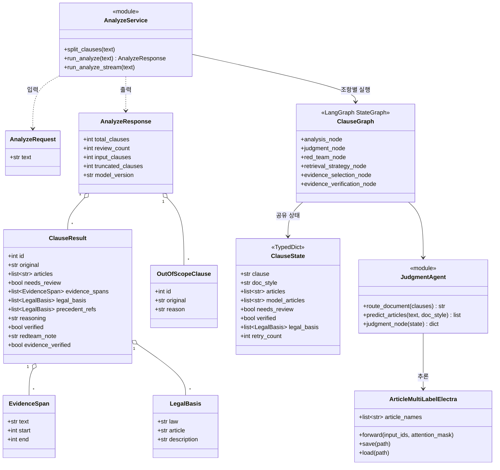
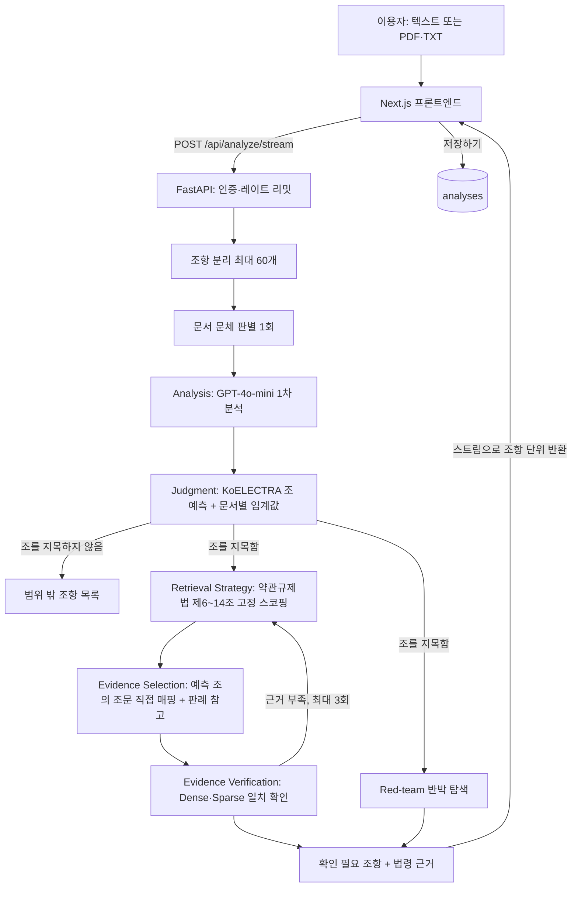
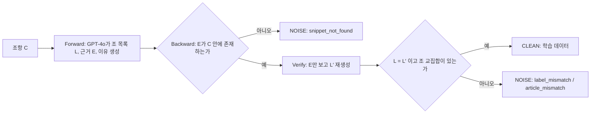
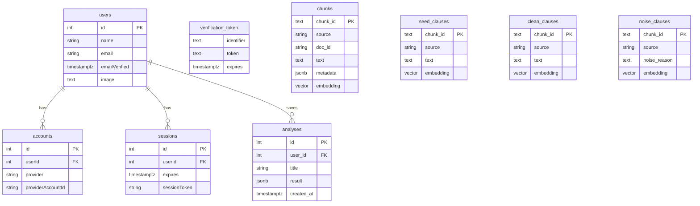

# 최종 보고서

**팀명:** --
**프로젝트명:** ContractRisk-Guard (서비스 화면 명칭: Verilex)
**팀원:** 김서연 (2202304002)

---

## 1. 프로젝트 개요

### 1.1 개요

최근 생성형 AI와 대규모 언어모델(Large Language Model, LLM)의 발전으로 법률 분야에서도 다양한 AI 기반 서비스가 등장하고 있다. 그러나 현재 대부분의 법률 AI 서비스는 질문에 대한 답변을 생성하거나 관련 판례 및 법령을 검색해 제공하는 수준에 머물러 있으며, 실제 법률 검토 과정에서 요구되는 다단계 판단 구조와 판단 근거에 대한 검증 절차를 충분히 반영하지 못하고 있다.

특히 생성형 AI는 존재하지 않는 판례나 법률 조항을 생성하는 환각(Hallucination) 문제를 일으킬 수 있으며, 법률 서비스에서 이러한 오류는 곧 신뢰성 문제로 이어진다. 이 문제는 이미 법률 AI 활용 사례에서 지적되고 있으며[1], 법률 질의에 대한 LLM의 환각을 체계적으로 분석한 연구에서도 확인된다[2]. AI가 생성한 결과의 근거와 그 근거를 검증하는 과정이 부족하다는 점이 주요 한계로 지적된다. 더 근본적인 문제는 검증의 준거가 모델 자신이라는 점이다. LLM이 생성한 라벨을 같은 계열의 LLM이 다시 확인하는 구조에서는 자기 일관성 편향(Self-consistency Bias)이 발생하여, 오류가 걸러지는 것이 아니라 오히려 누적된다. LLM이 자신이 생성한 출력을 알아보고 더 높게 평가하는 자기 선호 현상도 보고되어 있다[3]. 학습 데이터의 라벨 오류를 찾는 기존 방법인 Confident Learning[4]도 학습된 모델의 예측 확률에 의존하므로, 검증의 준거가 모델 안에 머문다는 한계를 공유한다.

또한 계약 조항의 법적 위험을 판단하기 위해서는 법령, 판례, 법령해석례, 행정기관의 처분 사례 등을 종합적으로 검토해야 하는데, 이러한 법률 정보는 서로 다른 시스템에 분산되어 관리된다.[5] 국가법령정보센터, 대법원 판례, 공정거래위원회 심결례가 각각 다른 형식과 접근 경로를 가지므로, 하나의 조항을 판단하기 위해 여러 출처를 오가며 대조하는 작업이 필요하다.

이러한 검토 비용을 가장 감당하기 어려운 쪽은 전문 인력을 갖춘 조직이 아니라 개인 이용자와 소상공인이다. 특히 약관은 사업자가 일방적으로 작성하고 고객은 동의 여부만 선택할 수 있는 구조여서, 조항의 불리함을 인지하지 못한 채 계약이 체결되는 정보 비대칭이 구조적으로 발생한다.[6] 해외에서는 온라인 서비스 약관에서 불공정 조항을 자동으로 탐지하는 연구가 이루어졌으나, 이는 영문 약관을 대상으로 EU 소비자 보호 법제를 기준으로 삼은 것이다[7]. 따라서 단순히 질문에 답변을 제공하는 형태를 넘어, 조항 분석 → 법령 확인 → 근거 검증 과정을 체계적으로 수행하고 그 근거를 원문과 함께 제시할 수 있는 AI 기반 계약 조항 분석 시스템이 필요하다.

본 프로젝트는 분석 대상을 「약관의 규제에 관한 법률」(이하 약관규제법) 제6조부터 제14조까지의 위반 소지가 있는 조항으로 설정하였다. 이 법을 선정한 이유는 두 가지다. 첫째, 무효로 판단되는 조항의 유형이 법 조문 자체에 열거되어 있어 판단 기준이 비교적 명확하다. 제7조(면책조항의 금지), 제9조(계약의 해제·해지), 제10조(채무의 이행) 등 각 조는 어떤 형태의 조항이 무효인지를 호(號) 단위로 규정한다. 둘째, 공정거래위원회가 실제로 시정조치를 내린 의결서가 공개되어 있어, 어떤 조항이 어떤 조를 위반했는지에 대한 공적으로 확정된 사례를 확보할 수 있다. 이는 전문가 라벨링에 수반되는 주관성 문제를 회피할 수 있는 근거가 된다.

설계 초기에는 분석 대상을 계약 해지 조항과 책임 제한 조항 두 가지 도메인으로 한정하였다. 그러나 파이프라인을 실제로 가동한 결과, 입력 조항 2,218건 중 1,257건(56.7%)이 두 도메인 중 어디에도 해당하지 않아 "해당없음"으로 폐기되었으며, 그중 상당수는 위반이 아닌 것이 아니라 분류 체계에 대응하는 항목이 없었던 실제 위반 조항이었다. 이에 따라 분류 체계를 약관규제법 제6~14조 다중 라벨(multi-label) 구조로 재설계하였다. 하나의 조항이 여러 조에 동시에 걸릴 수 있는 실제 법적 판단 구조와도 이 편이 부합한다.

따라서 본 프로젝트에서는 약관규제법 제6~14조를 기준으로 계약 조항의 위반 소지를 예측하고, 그 판단의 근거가 되는 법령 조문을 함께 제시하며, 학습 데이터의 라벨 품질 자체를 자동으로 검증하는 계약 조항 분석 시스템을 설계하고 구현하고자 한다.

### 1.2 주요 내용

본 프로젝트는 이용자가 입력한 계약서 또는 약관에서 조항을 자동으로 분리한 뒤, 각 조항이 약관규제법 제6~14조 중 어느 조를 위반할 소지가 있는지를 예측하고 해당 조문의 원문을 근거로 함께 제시하는 시스템이다. 기존 법률 AI가 검색과 요약 중심의 질의응답에 머물러 판단 근거의 정합성을 검증하는 구조가 없다는 한계를 해결하기 위해, Forward-Backward Consistency Check(이하 FB-Check) 기반의 라벨 자동 검증 기법과 역할이 고정된 다단계 처리 구조를 결합하여 설계하였다.

**주요 프로젝트 특징**

첫째, 학습 데이터의 라벨 품질을 자동으로 검증하고, 그 효과를 시스템 외부의 준거로 측정한다. LLM 자동 라벨링 과정에서 발생하는 환각 및 자기 일관성 편향 문제를 FB-Check 메커니즘으로 탐지하여 CLEAN으로 판정된 데이터를 학습에 사용한다. 효과는 파이프라인이 한 번도 본 적 없는 외부 준거, 즉 공정거래위원회가 의결서에서 실제로 인용한 법조문으로 채점하였다. 학습셋에 실제로 들어가는 라벨 기준으로 CLEAN의 조문 단위 F1은 42.8%(n=1,150), 배제된 NOISE는 39.0%(n=816)이며 차이는 +3.8%p(95% 신뢰구간 [+1.1, +6.6])다. 같은 문서 안에서만 무작위로 남긴 기준선과 비교하면 이득은 +0.8%p(학습셋 라벨 기준)~+2.4%p(필터 선별력 기준)로 줄어든다. 즉 라벨 수준에서 효과는 통계적으로 확인되지만 크기는 작다.

둘째, 판단의 주체를 분류 모델로 고정하고 LLM의 역할을 제한한다. 최종 판단은 파인튜닝된 KoELECTRA가 수행하며, GPT-4o 계열 모델은 조항의 1차 분석, 근거 문구 추출, 설명 생성에만 사용된다. LLM이 처리 흐름을 결정하거나 판단 결과를 변경하는 경로는 구조적으로 차단되어 있다. 이는 판단의 일관성을 확보하는 동시에 LLM 호출 비용과 지연을 줄인다. 또한 계약서 전체의 문체(공정위·표준계약서형 또는 회사 약관형)를 한 번 판별해 문서 종류별 판정 기준(임계값)을 달리 적용한다.

셋째, 검증된 주장과 검증되지 않은 주장을 화면에서 구분한다. "이 조항을 확인하라"는 조항 단위 지목은 단정적으로 제시하되, 조 단위 예측은 상수 기준선과 통계적으로 구분되지 않으므로 참고 정보로만 노출한다. 위험도 3단계와 신뢰도 수치는 정답을 정의할 근거가 없어 표시하지 않는다.

**프로젝트 기능**

- 조항 자동 분리: 계약서 전문에서 조 단위 텍스트를 분리한다(1회 최대 60개 조항, 초과분은 응답에 절삭 건수로 명시).
- 위반 소지 조 예측: 조항별로 제6·7·8·9·10·11·12·14조에 대한 다중 라벨 예측을 수행한다.
- 확인 필요 여부 판정: 모델이 조를 하나라도 지목하면 "확인 필요", 지목하지 않으면 범위 밖 조항으로 분리해 별도 목록에 표시한다.
- 문서 종류별 판정 기준: 계약서 전체의 문체를 판별해 표준계약서형과 회사 약관형에 서로 다른 임계값을 적용한다.
- 법령 근거 제시: 예측된 조에서 약관규제법 조문 원문을 직접 매핑한다. 검색을 경유하지 않으므로 무관한 법률이 근거로 혼입되지 않는다.
- 위험 문구 하이라이트: 근거 문구를 원문 인덱스에 매핑하여 어느 표현이 문제인지 표시한다(정규화·퍼지 매칭으로 공백·기호 차이를 흡수).
- 유사 판례 참고 제시: Hybrid 검색으로 관련 판례를 제시하되, 적중률이 낮아(hit@5 14%) 법령 근거와 구분되는 하위 위계로 노출한다.
- 근거 검증 및 재검색: 선택된 근거가 Dense·Sparse 양쪽 검색에서 모두 확인되지 않으면 검색 전략을 바꿔 최대 3회까지 재검색한다.
- 결과 저장 및 리포트 출력: 분석 결과를 저장해 히스토리에서 다시 열 수 있으며, 저장된 결과는 분석을 재실행하지 않고 그대로 재현된다. 인쇄 스타일을 통해 조항별 상세가 담긴 PDF 리포트도 출력할 수 있다.
- 계정 기반 이용: 분석 페이지는 Google 계정 로그인 후 이용할 수 있다. 이용료는 없으며, 로그인을 두는 이유는 과금이 아니라 오남용 방지와 개인 이력 분리다.

**사용 기술 및 방법론**

1. **데이터 구축**
   국가법령정보 공동활용 API[8]로 법령 5,585건, 판례 139,350건, 법령해석례 8,666건을 수집하고, 도메인 필터링으로 각각 16건·1,995건·26건을 선별한 뒤 청킹하여 총 33,801개 청크를 생성하였다. 학습 데이터는 공정거래위원회 심결례[9] PDF 3,359건을 내려받아 1,163건의 의결서를 파싱하고, 한국공정거래조정원 표준계약서[10]를 조항 단위로 분리하여 총 4,468건의 Seed 데이터를 구성하였다.
2. **라벨 검증(FB-Check)**
   Forward Labeling 단계에서 GPT-4o가 조항 텍스트 C로부터 위반 조 목록·근거 문구 E·판단 이유를 생성한다. Backward Grounding 단계는 근거 문구 E가 원문 C 안에 실제로 존재하는지를 문자열 인덱스 수준에서 검증한다. Consistency Verification 단계는 원문을 가린 채 근거 문구 E만으로 다시 라벨 L'을 생성한다. L = L'이고 근거 문구가 원문 안에 실제로 존재하면 CLEAN, 그렇지 않으면 NOISE로 분류하며, 위반 판정인데 조 교집합이 비는 경우도 NOISE로 처리한다. 이 단계에서 검증자로 모델을 투입하지 않는 것은 파이프라인 자신의 산출물이 그 파이프라인의 검증자가 될 수 없기 때문이다.
3. **모델 학습**
   CLEAN 데이터에 AI Hub[11]의 공정 약관 조항을 보강하여, KoELECTRA[12](ELECTRA[13] 기반 한국어 사전학습 모델, 110M) 위에 조 다중 라벨 분류 헤드를 얹어 파인튜닝하였다(sigmoid + BCE, 조별 독립 임계값). 같은 문서에서 나온 조항이 학습·검증 양쪽에 걸치지 않도록 문서 단위로 분할하였고, 임계값은 검증 스플릿에서만 조정하여 평가셋 정보가 새지 않도록 하였다.
4. **시스템 구현**
   조항 하나는 분석 → 판단 → (반박 탐색 · 근거 수집 → 근거 검증)의 고정 6단계를 통과한다. 각 단계는 LangGraph 노드로 배선되어 있으며 분기 조건은 코드에 고정되어 있다. 백엔드는 FastAPI, 프론트엔드는 Next.js 14, 데이터베이스는 PostgreSQL 16 + pgvector를 사용한다. 검색은 Dense(KoE5[14] 임베딩 + pgvector 코사인)와 Sparse(pg_trgm 문자 3-gram)를 Reciprocal Rank Fusion[15]으로 융합한다.

### 1.3 기대 효과 및 활용 방안

본 프로젝트를 통해 다음과 같은 효과를 기대할 수 있다.

첫째, 판단 근거의 신뢰성을 정량적으로 검증한 법률 AI 구조를 제시한다. 기존 법률 AI의 한계는 근거를 제시하지 않는다는 점보다, 제시한 근거가 옳은지 확인할 방법이 없다는 점에 있다. 본 프로젝트의 FB-Check는 이 검증을 자동화하며, 그 효과를 시스템 외부의 준거로 측정하였다. 공정거래위원회가 의결서에서 실제로 인용한 법조문을 정답으로 삼아 채점한 결과, FB-Check가 학습셋으로 남긴 라벨은 배제한 라벨보다 조문 단위 F1이 3.8%p 높았다(42.8% 대 39.0%, 95% 신뢰구간 [+1.1, +6.6], n=1,150/816). 이는 라벨러가 조문을 하나 이상 지목한 레코드를 대상으로 한 값이며, 파이프라인이 한 번도 본 적 없는 외부 기준으로 채점되었다는 점에서 자기 일관성 편향에 해당하지 않는다. 다만 효과의 크기와 한계도 함께 확인하였다. 같은 문서 안에서만 섞는 기준선을 쓰면 이득은 +0.8%p로 줄고, 모델 기반 기존 기법인 Confident Learning[4]과는 통계적으로 구분되지 않았으며(−0.3%p [−1.7, +1.2]), 이 라벨로 학습한 모델의 성능 향상은 다섯 차례 시도 모두 판정되지 않았다. 또한 화면에 표시되는 적용 법령은 검색 결과가 아니라 모델이 예측한 조에서 조문을 직접 매핑하므로, 유사도 상위에 무관한 법률이 섞여 들어오는 문제가 구조적으로 발생하지 않는다.

둘째, 개인 이용자가 계약 체결 전에 불리한 조항을 확인할 수 있는 진입 장벽 낮은 수단을 제공한다. 약관을 검토하려면 조항을 읽고, 관련 법령을 찾고, 그 조항이 무효 사유에 해당하는지 대조해야 하는데, 본 시스템은 이 과정을 자동으로 수행하여 확인이 필요한 조항과 관련 조문을 함께 제시한다. 별도 설치나 비용 없이 Google 계정 로그인만으로 텍스트 붙여넣기 또는 PDF·TXT 업로드를 통해 이용할 수 있어, 법률 지식이 없는 이용자도 계약 체결 이전 단계에서 조항의 위험 요소를 인지할 수 있다.

셋째, 법률 AI 연구에서 재현 가능한 평가 방법론을 제시한다. 본 프로젝트의 방법론적 기여는 시스템 구조 자체보다 그 성능을 판정하는 방식에 있다. 모든 성능 주장을 (가) 시스템 외부의 준거로 채점하고, (나) "항상 같은 답을 출력하는" 상수 기준선과 비교하며, (다) 95% 부트스트랩 신뢰구간[16](문서 단위 군집 재표집)을 함께 보고하는 절차를 적용하였다. 이 절차는 통상 보고되지 않는 부정적 결과를 다수 산출하였다. 검색 대상 법령을 LLM으로 라우팅하는 방식이 약관규제법 고정 스코핑이라는 상수에 100건 비교에서 0승으로 완패한 사례(적중률 18% → 81%), 조 단위 예측이 상수 기준선과 구분되지 않는 사례(조 F1 38.5% 대 상수 36.1%), GPT-4o 직접 추론이 조항을 짚는 능력(오경보)에서는 재현율을 맞추면 110M 모델과 구분되지 않지만 조 이름을 맞히는 능력에서는 앞선다는 사례(재현을 맞춘 조 F1 차이 +4.8%p [+0.9, +8.7], 4회 반복)가 그것이다. 또한 이 절차는 프로젝트 자신의 수치 일곱 건 이상을 스스로 정정·철회하게 하였고, 그 방향이 모델에 불리한 쪽으로 치우쳤는지 점검한 기록까지 남겼다.

넷째, 검증된 범위와 미검증 범위를 구분하여 제시하는 운영 방식을 확립하였다. 현재 시스템이 근거를 갖고 주장할 수 있는 것은 "이 조항을 확인하라"는 조항 단위 지목이다. 반면 조 단위 예측은 상수 기준선과 구분되지 않으므로, 화면에서 조문은 단정적 판정이 아니라 이용자가 법령을 찾아볼 출발점으로만 제시한다. 위험도 3단계와 신뢰도 수치는 정답을 정의할 근거가 없어 표시하지 않는다. 검증되지 않은 등급을 표시하는 것은 이용자에게 "검토했고 문제없다"는 거짓 확신을 주어, 오히려 누락보다 큰 피해로 이어질 수 있기 때문이다. 오경보율도 독립 준거가 없어 단일값으로 주장하지 않고, 정부 발행 표준계약서를 적법하다고 가정했을 때의 구간(2.8~12.1%)으로 제시한다.

**활용 방안.** 일차 대상은 계약 체결 전에 약관을 검토하려는 개인 이용자와 소상공인(B2C)이다. 향후 배포 환경의 위반 조항 유병률 측정을 통한 임계값 보정과 독립적으로 판정된 음성 표본을 통한 오경보율 측정이 완료되면 판정 강도를 상향할 수 있으며, 이 단계에 도달하면 기업 계약 검토 자동화 등 B2B 영역으로의 확장 기반으로도 활용될 수 있다.

---

## 2. 국내⦁외 관련 분야 현황

### 2.1 국내 관련 분야 현황

국내에서는 최근 법률 AI 서비스가 빠르게 증가하고 있으며, 판례 검색, 계약서 검토, 법률 상담 보조 등의 기능을 제공하는 다양한 서비스가 등장하고 있다. 특히 계약서 검토 자동화 기술은 기업 법무 분야에서 활용도가 높으며, 일부 기업에서는 AI를 활용한 계약 리뷰 서비스가 상용화되어 실제 법무 업무에 적용되고 있다. [17] 또한 학계에서도 법률 문서를 대상으로 한 자연어처리 연구가 활발히 진행되고 있으며, 법령 데이터를 기반으로 질의응답 시스템을 구축하거나 RAG 기반의 법률 QA 시스템 성능을 개선하는 연구가 진행되고 있다. [18][19]

그러나 현재 국내 법률 AI 시스템은 주로 질의응답 기반 구조에 의존하는 경우가 많아, 실제 법률 검토에서 요구되는 근거 검증 및 다단계 분석 기능은 제한적인 수준에 머물러 있다. 특히 학습 데이터의 라벨을 사람이 아닌 LLM으로 생성하는 접근이 확산되고 있음에도, 그 라벨이 옳은지를 모델 외부의 준거로 검증한 사례는 드물다. 본 프로젝트가 공정거래위원회 의결서의 인용 법조문을 외부 정답으로 삼아 라벨 필터의 효과를 측정한 것은 이 공백을 겨냥한 것이다.

### 2.2 국외 관련 분야 현황

국외에서는 생성형 AI와 RAG 기술을 결합한 법률 AI 연구가 활발하게 진행되고 있으며, 특히 Agentic AI 구조를 활용한 법률 시스템 연구가 증가하고 있다. Pham 외(2025)는 베트남 법률 시스템을 대상으로 여러 개의 전문 Agent를 활용한 Agentic RAG 기반 법률 상담 챗봇을 제안하였으며, 해당 연구에서는 법령, 판례, 규정 등 다양한 법률 지식을 통합하여 법률 질의응답 성능을 향상시킨 바 있다. [20] 또한 자연어처리 연구 분야에서는 RAG 기반 생성 시스템의 신뢰성을 향상시키기 위해 생성 결과가 실제 근거 문서와 일치하는지를 실시간으로 모니터링하는 연구가 진행되고 있으며, 이러한 접근은 법률과 같이 높은 정확성이 요구되는 분야에서 중요한 연구 방향으로 평가되고 있다. [21] 약관 분야에서는 온라인 서비스 약관의 불공정 조항을 기계학습으로 자동 탐지하는 CLAUDETTE 연구가 있으나[7], 영문 약관과 EU 소비자 보호 법제를 대상으로 한다.

이와 같이 해외에서는 단순 QA 시스템을 넘어 근거 기반 생성 및 검증 중심의 법률 AI 연구가 진행되고 있으며, 법률 AI의 신뢰성과 실무 활용성을 동시에 향상시키는 방향으로 발전하고 있다. 다만 이러한 연구들이 공통적으로 채택하는 다중 Agent 구조에 대해, 본 프로젝트는 실측을 통해 다른 결론에 도달하였다. 검색 대상 법령을 LLM Agent가 선택하도록 한 구조는 "항상 약관규제법을 검색한다"는 고정 규칙에 100건 비교에서 한 번도 이기지 못했다. 이는 Agent 구조 자체를 부정하는 결과가 아니라, 도메인이 충분히 좁을 때는 자율적 판단보다 고정된 규칙이 우월할 수 있으며 그 판정을 위해 상수 기준선과의 비교가 반드시 선행되어야 함을 시사한다.

### 2.3 접근 방식 비교

| 구분 | 질의응답형 법률 AI (국내외 RAG 연구) | 계약서 검토 자동화 서비스 (국내 상용) | 불공정 약관 탐지 연구 (CLAUDETTE) | 본 프로젝트 |
|---|---|---|---|---|
| 주된 기능 | 법령·판례 검색 후 답변 생성 | 기업 법무용 계약 리뷰 | 영문 온라인 약관의 불공정 조항 탐지 | 약관규제법 제6~14조 위반 소지 조항 지목 |
| 판단 주체 | LLM 또는 다중 Agent | 서비스별 상이 | 지도학습 분류기 | 파인튜닝된 분류 모델(LLM은 설명만) |
| 근거 제시 | 검색된 문서 인용 | 서비스별 상이 | 불공정 유형 표시 | 예측 조의 조문 원문 직접 매핑 |
| 학습 데이터 라벨 | 해당 없음 | 비공개 | 전문가 주석 코퍼스 | LLM 자동 라벨 + FB-Check 검증, 외부 준거로 효과 측정 |
| 적용 법제 | 다양 | 다양 | EU 소비자 보호 법제 | 한국 약관규제법 |
| 성능 주장의 검증 | 질의응답 정확도 중심 | 비공개 | 분류 성능 | 외부 준거 + 상수 기준선 + 신뢰구간 |

(국내 상용 서비스 칸은 공개된 정보만으로 확인할 수 없어 일반적 기능 범주로만 적었다.)

---

## 3. 프로젝트 개발 환경

### 운영체제

| 항목 | 내용 |
|---|---|
| OS | Ubuntu 24.04.4 LTS (Noble Numbat) |
| GPU | NVIDIA RTX 5000 Ada Generation (학습·평가는 cuda:1 고정) |
| CUDA | CUDA 12.4 (PyTorch cu124 빌드 기준) |

### 개발 도구

| 항목 | 내용 |
|---|---|
| IDE, CLI | VS Code |
| 버전 관리 | Git, GitHub |
| CI | GitHub Actions — BE(린트 + 단위 테스트), FE(린트 + 타입 체크 + 단위 테스트) |
| 린터 | Ruff 0.16.5 — 규칙 F(버그류), I(import 순서), CI에서 강제 |
| 코드 포맷터 | 사용하지 않음 (측정 후 결정: 110개 파일 재포맷, 정렬된 한글 주석 훼손) |
| 테스트 | pytest 9.0.3, pytest-asyncio 1.3.0, httpx 0.28.1 (백엔드 143건, 통합 테스트 제외) / Jest 29, Testing Library (프론트엔드) |
| DB 마이그레이션 | Alembic 1.18.5 |
| 환경 변수 관리 | python-dotenv 1.2.3 |
| 설정 검사 | check_env_file.py로 .env가 동일하게 읽히는 형식인지 검사 |
| 가상환경 | Python venv(.venv/) |

### 개발 언어

| 언어 | 버전 | 용도 |
|---|---|---|
| Python | 3.12 (서빙 이미지·CI) / 3.10 (로컬 학습·평가 환경) | 백엔드 (데이터 수집, 전처리, 모델 학습, API 서버) |
| TypeScript | 5.x | 프론트엔드 전체 |

### 의존성 관리

하한만 명시된 파일로 이미지를 빌드하면 빌드 시점마다 최신 메이저 버전으로 올라간다. 실제로 락 도입 전 빌드에서 이미지의 의존성이 개발 환경과 openai 2.36 → 3.6, pandas 2.3 → 3.0, sentence-transformers 5.4 → 6.0 만큼 벌어진 채로 통과한 적이 있었다. 그날은 동작했으나 다음 빌드가 같은 이미지라는 보장이 없었으므로, 이미지 빌드에는 pip freeze 산출물인 락 파일을 사용하도록 분리하였다. 따라서 서빙 이미지의 라이브러리 버전은 아래 개발 환경 표와 일치하지 않으며, 락 파일이 그 조합을 고정한다.

| 파일 | 의도 | 사용처 |
|---|---|---|
| requirements.txt | `>=`으로 하한선만 기재 | 로컬 서버 기동, 버전 정책의 단일 출처 |
| requirements-lock.txt | 도구로 생성한 실제 동작 조합 | Docker 이미지 빌드 전용 |
| requirements-dev.txt | 수집, 전처리, 라벨링을 포함한 파이프라인 작업 시 전체 개발 환경 | 개발 |

### 프레임워크 및 주요 라이브러리

**1. 백엔드 (Python)**

| 분류 | 라이브러리 | 버전 |
|---|---|---|
| API 서버 | FastAPI, Uvicorn | 0.136.1 / 0.46.0 |
| 데이터 검증 | Pydantic | 2.13.3 |
| 딥러닝 프레임워크 | PyTorch | 2.6.0+cu124 |
| NLP, 트랜스포머 | HuggingFace Transformers | 5.7.0 |
| 임베딩 | sentence-transformers | 5.4.1 |
| 오케스트레이션 | LangGraph | 1.2.9 |
| LLM 클라이언트 | OpenAI | 2.36.0 |
| DB 드라이버 | psycopg2-binary | 2.9.12 |
| ML | scikit-learn | 1.7.2 |
| 데이터 처리 | pandas, numpy | 2.3.3 / 2.2.6 |
| PDF 파싱 | pypdf, pdfplumber | 6.13.0 / 0.11.9 |
| 웹 크롤링 | Playwright, requests | 1.59.0 / 최신 버전 |
| HWP 파싱 | olefile | 0.47 |
| 학습 모델 | KoELECTRA (koelectra-base-v3-discriminator, 110M) | HuggingFace Hub |
| 실험용 sLLM (평가 전용, 서빙 미사용) | EXAONE-3.5-7.8B, Qwen2.5-14B, Llama-3.1-8B (LoRA 미세조정) | HuggingFace Hub |

**2. 프론트엔드 (TypeScript)**

| 분류 | 라이브러리 | 버전 |
|---|---|---|
| 프레임워크 | Next.js (App Router) | 14.2.35 |
| UI 런타임 | React, React DOM | 18 |
| 스타일링 | Tailwind CSS | 3.4.1 |
| UI 컴포넌트 | shadcn/ui, class-variance-authority, tailwind-merge, clsx | 4.10.0 / 0.7.1 / 3.6.0 / 2.1.1 |
| 서버 상태 | TanStack React Query | 5.101.0 |
| 인증 | NextAuth.js, @auth/pg-adapter, pg | 4.24.15 / 1.11.3 / 8.22.0 |
| 아이콘 | lucide-react | 1.17.0 |
| 테스트 | Jest, jest-environment-jsdom, Testing Library | 29.7.0 / 16.1.0 |

**3. 인프라 및 외부 서비스**

| 항목 | 내용 |
|---|---|
| 데이터베이스 | PostgreSQL 16 + pgvector (Docker 컨테이너) — 벡터 검색용 HNSW 인덱스와 어휘 검색용 pg_trgm GIN 인덱스를 함께 사용 |
| 서버 이미지 | python:3.12-slim 기반. requirements-lock.txt로 빌드하며 PyTorch만 별도 인덱스에서 버전을 고정하여 설치. models/, data/와 HuggingFace 캐시를 이미지에 굽지 않고 런타임에 읽기 전용 볼륨으로 마운트 |
| 외부 LLM | OpenAI GPT-4o (Forward Labeling), GPT-4o-mini (서빙 단계 1차 분석) |
| 임베딩 모델 | nlpai-lab/KoE5 (1024차원, 로컬 GPU 추론) — 벤치마크 결과에 따라 OpenAI에서 교체 |
| 공공 데이터 API | 국가법령정보 공동활용 API (법령, 판례, 법령해석례 수집) |
| 데이터 출처 | 공정거래위원회 심결례 PDF, 한국공정거래조정원 표준계약서(HWP), AI Hub 약관 데이터 |
| API 보호 | 헤더 기반 API 키 인증, 인메모리 레이트 리밋(분당 20회), 동시 분석 4건, 조항 동시 처리 6건 제한, PDF 업로드 10MB 제한 |

---

## 4. 프로젝트 설계 및 구현

### 4.1 아키텍처

**전체 구조 개요**

두 개의 데이터 구축 경로와 하나의 서비스 경로로 구성된다. 첫째 트랙은 판단의 근거가 되는 법률 코퍼스를 만든다(수집 → 도메인 필터링 → 청킹 → 벡터 적재). 둘째 트랙은 판단의 능력을 만든다(Seed 라벨링 → FB-Check → 모델 학습). 서비스 경로는 학습된 모델로 판단하고 코퍼스와 조문 매핑으로 근거를 붙인다. 백엔드는 역할 단위 패키지(agents, api, db, domain, fb_check, labeling, model, preprocess, retrieval, scripts, training)로 분리되고, 평가 스크립트는 최상위 `eval/` 디렉터리로 분리되어 있으며, 프론트엔드는 별도 패키지다.

**구성 요소별 동작 원리**

1. **데이터 수집**
   국가법령정보 공동활용 API로 법령 5,585건, 판례 139,350건, 법령해석례 8,666건을 수집한다. 공정거래위원회 심결례는 목록을 Playwright로 크롤링한 뒤 PDF 3,359건을 내려받아 텍스트를 추출하며, 추출 결과는 캐시하여 재파싱 시 파일을 다시 읽지 않는다. 표준계약서는 HWP 파일을 olefile과 zlib으로 파싱하여 JSON으로 저장한다.

2. **도메인 필터링**
   수집된 원천에서 대상 도메인 문서만 선별한다. 법령은 법령명 메타데이터를 직접 매칭하여 16건, 판례는 사건종류명으로 형사·가사·세무·특허 등을 제외한 뒤 약관·계약해지·책임제한 등 9개 키워드로 필터링하여 1,995건, 법령해석례는 안건명에 대상 법령명이 포함되는지로 26건을 선별한다. 세 경로 모두 임베딩을 사용하지 않는다. 설계 초안에는 Dense Retrieval 기반 필터링이 있었으나 채택하지 않았다.

3. **전처리**
   필터링을 통과한 문서를 청킹·정제하여 `{chunk_id, source, doc_id, chunk_index, text, metadata}` 형태의 JSONL로 저장한다. 법령은 3,463청크, 판례는 30,154청크, 해석례는 184청크가 생성된다.

4. **Seed 라벨링**
   전문가 라벨 없이 초기 학습 데이터를 구성한다. 공정위 의결서 1,163건과 표준계약서를 규칙 기반으로 조항 단위 분리하여 총 4,468건(의결서 유래 2,432건, 표준계약서 유래 2,036건)을 생성한다. 의결서에서 나온 조항은 공적으로 위반이 확정된 것이고, 표준계약서 조항은 위반이 없는 쪽의 표본이 된다.

5. **1차 모델 학습**
   Seed 데이터로 KoELECTRA를 파인튜닝하여 1세대 모델을 학습한다. 이 모델의 예측은 FB-Check의 Backward 단계에서 기록용으로만 남기며 CLEAN/NOISE 판정에는 쓰지 않는다. 파이프라인 자신의 산출물이 그 파이프라인의 검증자가 될 수 없기 때문이다.

6. **Forward-Backward Consistency Check**
   학습 데이터의 노이즈를 자동 탐지하는 핵심 알고리즘이다. Forward 단계에서 GPT-4o가 조 목록·근거 문구·판단 이유를 생성하고, Backward 단계에서 근거 문구가 원문에 실제로 존재하는지 문자열 인덱스로 검증하며, Verify 단계에서 근거 문구만으로 재라벨링한 결과가 최초 라벨과 일치하는지 확인한다. 전체 입력 4,466건 중 4,465건이 처리되어(1건은 오류로 미처리) **CLEAN 3,352건(75.1%), NOISE 1,113건(24.9%)**으로 분류되었다. NOISE 사유는 라벨 불일치 922건, 조 교집합 불일치 158건, 근거 문구 미존재 33건이다. CLEAN에서 제13조의 지지 표본은 5건뿐이어서 이후 학습에서는 제13조를 라벨에서 접었다.

7. **조 다중 라벨 재학습과 문서 종류 대응**
   CLEAN 데이터로 조 다중 라벨 모델을 학습한다. 문서 단위로 분할하고, 체크포인트 선택은 검증 분할의 macro F1(제6조 제외)로 하며, 평가셋(255건)은 선택에 관여하지 않는다. 지지 표본이 5건 미만인 제13조는 라벨에서 접었다.
   - **article_v2**: 라벨링 중간 시점의 CLEAN으로 학습한 모델이다(학습 963건, 검증 366건, 평가 255건). 입력 길이 상한은 512 토큰이다.
   - **article_v3 (현행 서빙)**: 완료된 CLEAN 데이터에 AI Hub의 공정 약관 조항 1,500건을 보강해 학습한 모델이다(학습 2,999건, 검증 856건). 외부 평가에서 공정위·표준계약서 문체에 맞춘 임계값이 실제 회사 약관의 공정 조항에서 오경보를 크게 일으키는 것이 확인되어(4.4 참조), 문서 종류별로 임계값 두 벌을 두고 계약서 전체의 문체를 판별하는 TF-IDF 기반 라우터(학습: 회사 약관 4,361건, 표준계약서 1,525건)를 함께 승격하였다.

8. **서비스 동작**
   `run_analyze`는 입력을 조항으로 분리한 직후 문서 전체를 한 번 판별해 문체(회사 약관형/표준계약서형)를 정하고, 그 값을 모든 조항에 전달한다. 조항 하나는 6단계를 통과한다. Analysis(GPT-4o-mini 1차 분석) → Judgment(KoELECTRA 조 예측, 문서 문체에 맞는 임계값 적용) → 게이트 → Red-team(반박 탐색)과 Retrieval Strategy → Evidence Selection → Evidence Verification(근거 검증, 최대 3회 재검색)의 두 브랜치로 분기한다. 게이트는 모델이 조를 하나도 지목하지 않으면 두 브랜치를 모두 건너뛰고 해당 조항을 범위 밖으로 반환한다. 라우터가 없는 체크포인트(article_v2 등)로 서빙하면 문체 판별 없이 단일 임계값으로 동작한다. 서비스 경로와 평가 경로가 같은 값을 내는지 1,155개 조항으로 대조하여 불일치 0건을 확인하였다.

9. **성능 평가 방법과 결과**
   모든 성능 주장은 (가) 파이프라인이 보지 않은 외부 준거로 채점하고, (나) 항상 같은 답을 내는 상수 기준선과 비교하며, (다) 95% 부트스트랩 신뢰구간(문서 단위 군집 재표집)을 병기하며, (라) 판정 규칙을 실험 전에 문서로 확정(사전 등록)한다는 네 가지 원칙으로 보고한다. 평가 준거는 두 가지다. 하나는 공정거래위원회 의결서가 인용한 법조문으로, 단일 조항이면서 인용 조문도 하나인 255건만 조항 단위 정답(gold)으로 쓴다. 의결서 1,163건을 전수 조사한 결과 이보다 큰 정답셋은 만들 수 없음을 확인하였다. 다른 하나는 "정부가 발행한 표준계약서는 적법하다"는 출처 준거로 만든 음성 풀이다.

   **(1) 라벨 필터(FB-Check)의 효과**

   | 비교 | 결과 | 판정 |
   |---|---|---|
   | 학습셋에 들어가는 라벨(agreed): CLEAN vs NOISE, 외부 준거 조문 F1 | 42.8% (n=1,150) vs 39.0% (n=816), +3.8%p [+1.1, +6.6] | 유의 |
   | 같은 라벨러의 forward 라벨: 필터 선별력 | 46.7% (n=1,158) vs 39.0%, +7.7%p [+5.1, +10.3] | 유의 |
   | 같은 문서 안에서만 섞는 무작위 제거 대비 | forward +2.4%p, agreed +0.8%p (p<0.01) | 유의하나 작음 |
   | 귀속 모호성이 없는 층(조항 1·근거 1) | +6.9%p [−4.6, +18.5] (NOISE 92건, 필요 약 601건) | 미판정 |
   | 기존 기법 Confident Learning과 비교 | −0.3%p [−1.7, +1.2] | 구분 안 됨 |
   | 이 라벨로 학습한 모델의 외부 성능(20 시드) | AUROC +1.50%p [−0.41, +3.41] | 미판정 (다섯 차례 시도 모두) |
| 조항 단위 전문가 정답(AI Hub 5,150건, 검증자 Qwen2.5-14B): 남긴 라벨 F1 대 같은 수 무작위 | 39.2% 대 32.2%, +7.0%p (p<0.0001, 사전 등록 기준 통과) | 유의 |
| 같은 비교에서 첫 판정의 위험 등급 비율을 맞춘 무작위 대비 | +2.9%p (p=0.0006) | 유의하나 작음 |

   FB-Check는 라벨 수준에서 외부 준거에 더 잘 맞는 라벨을 골라내지만, 그 이득이 하류 모델의 성능 향상으로 식별되지는 않았다.

   **(1-2) 조항 단위 전문가 정답에서의 FB-Check: 무엇을 걸러내고 무엇을 못 거르는가**
   AI Hub 약관 데이터(위반 조항 2,575건과 같은 수의 공정 조항)에서 FB-Check를 조문 단위 정답으로 채점하였다. 판정 규칙은 결과를 보기 전에 문서에 적어 두었다. 검증자는 비용 문제로 GPT-4o가 아니라 로컬 Qwen2.5-14B(4비트)를 썼다.

   | 라벨 종류 | 건수 | FB-Check가 걸러낸 비율 [95% CI] |
   |---|---|---|
   | 위반이 아닌데 위반이라 붙은 라벨 (판별 오류) | 877 | 72.2% [69.2, 75.2] |
   | 위반은 맞지만 조가 틀린 라벨 (조 오류) | 1,133 | 50.8% [47.8, 53.8] |
   | 위반과 조가 모두 맞는 라벨 | 574 | 56.4% [52.2, 60.6] |

   판별 오류는 정답 라벨보다 15.7%p 더 걸러내지만(95% 신뢰구간 +10.4~+21.0), 조 오류는 오히려 5.6%p 덜 걸러낸다(−10.9~−0.3). 또 위반 조항의 33.7%는 첫 판정이 빈 라벨로 놓치는데, 검증 단계가 이를 되살린 비율은 8.9%(6.6~11.2)에 그쳤다. 즉 FB-Check는 "붙은 라벨이 맞는가"를 검사할 뿐 "붙어야 할 라벨이 빠졌는가"는 거의 찾지 못한다.

   이 결과의 세 가지 단서를 함께 적는다. 첫째, 이득의 상당 부분은 첫 판정이 스스로 낸 위험 등급으로 설명된다. 등급이 High인 라벨만 남기는 단순 규칙이 FB-Check보다 높은 F1(43.9%, 1,375건)을 보였다. 둘째, 위험 등급 비교를 뺀 2진 규칙을 같은 방식으로 GPT-4o 라벨에서 확인했을 때 기존 규칙보다 1.6%p 낮았다(45.1% 대 46.7%, [−2.6, −0.7]). 따라서 등급 비교를 빼는 단순화는 확증되지 않았다. 셋째, 위 오류 종류별 분석은 결과를 본 뒤에 수행한 사후 분석이다.

   **(1-3) 놓친 위반을 찾는 누락 검사**
   FB-Check 뒤에 다른 계열 모델(현행 분류 모델)이 위반으로 짚었는데 LLM 라벨이 비어 있는 조항을 위반으로 고치는 단계를 더해 보았다.

   | 평가 | 결과 | 판정 |
   |---|---|---|
   | AI Hub 평가 절반 2,571건, 조항 단위 전문가 정답 | 데이터 오류율 28.8% → 21.3% (−7.49%p [−8.93, −6.02]). 표시한 148건의 94.6%가 실제 위반(빈 라벨 전체의 기저율 30.9%). 놓친 위반 382건 중 140건 회수, 새 오경보 8건 | 사전 등록 기준 통과 |
   | 운영 GPT-4o 학습 데이터 4,465건, 출처 가정 채점 | 표시분 중 공정위 조항 비율 13.5%가 기저율 16.8%보다 낮고 문체만 보는 기준선(55.9%)에 −42.4%p. 추정 오류율 15.1% → 27.6%로 악화 | 기준 미달 |

   두 결과가 갈리는 원인은 확인하지 못했다. 앞의 교차 확인 모델은 AI Hub 공정 조항으로 오경보를 낮춘 모델(시험 오경보 약 4%)이고, 뒤의 모델은 그런 장치가 없어 외부 오경보가 30% 안팎이라는 차이가 있다. 따라서 누락 검사의 이득은 "오경보가 낮은 교차 확인 모델과 조항 단위 전문가 정답이 있을 때"로 한정하여 주장한다.

   **(1-4) 학습 효과를 얻으려는 다섯 차례 시도**

   | 시도 | 설계 | 외부 AUROC 차이 [95% CI] | 판정 |
   |---|---|---|---|
   | 1 | FB-Check 필터 대 같은 수 무작위, 10시드 | +2.26%p [−0.64, +5.16] | 미판정 |
   | 2 | 위와 같음, 20시드 | +1.50%p [−0.41, +3.41] | 미판정 |
   | 3 | 위험 등급 비교를 뺀 2진 규칙, 10시드 | +1.03%p [−1.78, +3.84] | 미판정 |
   | 4 | 버리지 않고 확신도(1.0/0.5)로 학습(FB-Check v2), 10시드 | +0.76%p [−2.24, +3.76] (조 F1은 기존 FB-Check보다 +3.0%p [+1.1, +4.9]) | 미판정 |
   | 5 | 표준계약서 쪽 NOISE만 제외(원인 확인), 10시드 | 조 F1 +1.48%p [−0.66, +3.62], AUROC +1.28%p [−2.25, +4.81] (97.5% CI) | 미판정 |

   다섯 차례 모두 판정되지 않았고, 효과가 있더라도 AUROC 기준 약 +3.8%p를 넘지 않는다. 학습 데이터를 출처로 추정해 보면 FB-Check는 위반이 아닌데 위반이라 붙은 라벨의 추정 비율을 16.1%에서 12.7%로 낮추지만, 위반 사례를 함께 버려 놓친 위반의 추정 비율을 14.2%에서 21.3%로 높인다(출처 가정에 기댄 추정). 오류의 종류가 바뀌었을 뿐 학습 데이터 전체의 오류가 줄지 않았다는 뜻이며, 이것이 하류 효과가 식별되지 않은 이유로 보이나 학습 실험으로 확인된 인과는 아니다.

   **(2) 분류 모델의 성능 (article_v2, 조항 단위 정답 255건)**

   | 지표 | 값 | 상수 기준선·비고 |
   |---|---|---|
   | 조항 단위 재현(이진, "이 조항을 확인하라") | 78.4% | 오경보와 함께 해석 |
   | 조 단위 F1 (255건 전체) | 38.5% | 상수 최고 36.1% 대비 +2.4%p [−4.0, +9.1], 미판정 |
   | 조 단위 F1 (모델이 지목한 200건) | 49.1% | 상수 35.5% 대비 +13.6%p [+6.1, +21.2] (사전 등록 판정) |
   | 오경보 (표준계약서 온전 조항 908건) | 12.1% [9.9, 14.7] | 그중 GPT도 짚지 않은 순수 모델 오경보 2.8% [1.8, 3.9] |
   | 오경보 (홀드아웃 12문서) | 5.3% [3.9, 6.9] | 해당 문서는 GPT 기준으로도 2배 쉬운 문서 |
   | 서빙 비용 | 조항당 6ms, GPU 429MB | GPT-4o 직접 추론은 약 1.8s |

   조 단위 F1은 255건 전체에서 상수와 구분되지 않는다. 3%p 차이를 가리려면 약 3,400건이 필요한데 확보 가능한 정답은 255건이므로, 이 준거로는 조 이름을 단정할 수 없다. 오경보율은 표준계약서를 적법하다고 가정한 값이어서 단일값이 아니라 2.8~12.1% 구간으로 보고한다.

   **(3) 현행 서빙 구성(article_v3 계열: AI Hub 보강 + 문서 문체 라우팅)**
   아래 값은 동일 구성의 3시드 평균이며 비교 기준(C)은 KoELECTRA FB-Check 팔의 3시드 평균이다. 배포 체크포인트는 그중 시드 7이다.

   | 지표 | 기준(C) | 현행 구성 | 차이 [95% CI] |
   |---|---|---|---|
   | AI Hub 공정 조항 오경보 (평가 절반) | 26.8% | 4.3% | −22.5%p [−27.3, −17.7] |
   | AI Hub 위반 조항 재현 | 64.6% | 67.1% | +2.5%p [−1.6, +6.5] (구분 안 됨) |
   | 공정위 정답 255건 재현 | 79.9% | 89.9% | +10.1%p [+6.4, +13.7] (임계값 이동, 아래 참조) |
   | 표준계약서 홀드아웃 오경보 | 6.7% | 7.4% | +0.8%p [−3.6, +5.2] (구분 안 됨) |
   | 실제 기업 약관 10개 지목률 | 22.4% | 29.1% | +6.6%p [−5.8, +19.1] (정답 없음) |

   임계값을 맞춘 AI Hub 학습 절반과 평가 절반이 같은 출처이므로 오경보 감소가 실제보다 좋게 나왔을 수 있다. 실제 기업 약관에는 정답이 없어 지목률 변화의 정오는 알 수 없다. 공정위 정답에서 재현이 오르는 데에는, 정답 문서의 83.9%가 회사 약관형으로 분류되어 더 완화된 임계값이 적용된 영향이 큰 것으로 보인다. 실제로 라우팅을 포함한 배포 상태에서 공정위 정답 255건의 조 F1은 30.4% [27.3, 33.5]로 상수 기준선(36.1%)보다 낮았고, 라우팅 없이 기본 임계값을 쓴 경우는 37.6% [32.3, 42.7]로 상수와 구분되지 않았다. 재현율 상승(70.2% → 90.2%)은 정밀도 하락을 동반한 동작점 이동이므로, 이 구성의 성과는 외부 회사 약관의 오경보 감소(26.8% → 4.3%)로 한정하여 주장한다.

   **(4) 대안 모델과의 비교**

   | 비교 대상 | 결과 | 해석 |
   |---|---|---|
   | GPT-4o 직접 추론 (4회 반복) | 조 F1 +7.4%p [+3.2, +11.6], 재현을 맞추면 +4.8%p [+0.9, +8.7]. 재현을 맞춘 오경보는 +0.3%p [−2.8, +5.0]로 구분 안 됨 | 조항을 짚는 능력은 동률, 조 이름은 GPT가 앞선다. 비용·지연은 약 300배 |
   | TF-IDF + 로지스틱 회귀 (balanced, 검증 임계값) | 조 F1 41.3% (KoELECTRA 38.5%와 미판정). 재현 80%대에서 KoELECTRA 오경보가 4~5%p 낮음 | 조 단위로는 단순 기준선과 구분 안 됨 |
   | 디코더 sLLM + LoRA[22] (EXAONE 3.5 7.8B[23], Qwen2.5 14B[24]) | 같은 재현에서 인코더 대비 오경보 4.6%p [+1.9, +6.8](EXAONE), 3.8%p [+0.4, +6.5](Qwen) 낮음. 조 F1은 미판정 | GPU 메모리 429MB 대 14,957MB(35배)라 서빙에는 적용하지 않음. Qwen2.5는 Apache 2.0, EXAONE은 비상업 라이선스 |

   **(5) 강건성**
   문구를 바꿔 쓴 변형문에서 article_v2의 위반 재현은 78.5%에서 57.8%로 떨어졌다(−20.7%p [−28.9, −13.3]). KLUE-RoBERTa는 유지되었으나 처음 보는 표준계약서 문서의 오경보가 5.3%에서 14.0%로 늘어(+8.7%p [+0.3, +19.7]) 사전 규칙에 따라 교체하지 않았다. 문체를 상업 약관풍으로 바꾸면 article_v2의 오경보는 2.6%에서 5.9%로 늘었다(McNemar p=0.002).

**구성 요소 간의 관계**

판단 주체는 Judgment 단계의 분류 모델로 고정되어 있다. Analysis 단계의 LLM 출력은 근거 문구 추출과 설명 생성에만 쓰이며, 두 결과가 같은 조를 지목했는지를 일치 여부로만 기록한다(신뢰도가 아니다). Red-team 단계는 판정 필드를 출력 스키마에 아예 갖지 않아 LLM이 판단 결과를 변경할 수 없다. Evidence Selection 단계는 Judgment의 예측 조를 읽어 조문을 매핑하므로 두 단계 사이에 상태 의존성이 있으며, 이 때문에 이전의 병렬 구조를 직렬로 되돌렸다. 문서 문체 판별은 파이프라인 시작 전에 한 번만 수행되어 Judgment 단계의 임계값 선택에만 영향을 준다.

**외부 환경과의 관계**

| 외부 시스템 | 연동 방식 | 용도 |
|---|---|---|
| 국가법령정보 공동활용 API | REST API (requests) | 법령, 판례, 해석례 원천 데이터 수집 |
| 공정거래위원회 웹사이트 | Playwright 크롤링 + PDF 다운로드 | 심결례 원문 확보, 학습 데이터 및 외부 평가 정답 |
| OpenAI GPT-4o | OpenAI Python SDK | Forward Labeling(라벨 생성) |
| OpenAI GPT-4o-mini | OpenAI Python SDK | 서빙 단계 1차 분석 및 설명 생성 |
| Qwen2.5-14B (로컬) | transformers, bitsandbytes 4비트 | FB-Check 검증 단계(GPT 비용 중단을 대체), API 호출 없음 |
| KoE5 임베딩 모델 | sentence-transformers (로컬 GPU) | 벡터 임베딩 생성, 외부 API 호출 없음 |
| PostgreSQL 16 + pgvector | psycopg2 (Docker 컨테이너) | 청크·조항 벡터 저장, 유사도 검색, 사용자 및 분석 이력 |
| Google OAuth | NextAuth.js | 로그인 |
| AI Hub | 데이터 내려받기 | 공정 약관 조항 학습 보강, 외부 평가 |

### 4.2 설계도

> 아래 다이어그램은 Mermaid 코드다. https://mermaid.live 에 붙여 넣어 이미지로 내보낸 뒤 삽입한다.

**클래스 다이어그램**

**분석 파이프라인 및 API 흐름**

**FB-Check 파이프라인**

**데이터베이스 ER 다이어그램**

**테이블 명세서**

*chunks — 법령·판례·해석례 청크 (검색 대상)*

| 컬럼 | 타입 | 제약 | 설명 |
|---|---|---|---|
| chunk_id | TEXT | PK | 청크 식별자 |
| source | VARCHAR(20) | NOT NULL | 출처 구분(법령/판례/해석례) |
| doc_id | VARCHAR(200) | | 원문서 ID |
| rec_index | INTEGER | | 원문서 내 레코드 번호 |
| chunk_index | INTEGER | | 청크 순번 |
| text | TEXT | NOT NULL | 청크 본문 |
| metadata | JSONB | | 법령명·조번호·법원 등 메타데이터 |
| embedding | vector(1024) | | KoE5 임베딩 |

인덱스: `chunks_source_idx`(source), `chunks_embedding_idx`(HNSW, 코사인, m=16, ef_construction=64), `chunks_text_trgm_idx`(GIN, pg_trgm).

*seed_clauses — Seed 라벨 조항*

| 컬럼 | 타입 | 제약 | 설명 |
|---|---|---|---|
| chunk_id | TEXT | PK | |
| source | VARCHAR(30) | NOT NULL | 의결서 또는 표준계약서 |
| doc_id | VARCHAR(200) | | |
| text | TEXT | NOT NULL | 조항 원문 |
| domain | VARCHAR(20) | | 옛 2도메인 라벨(폐기된 체계) |
| risk_level | VARCHAR(10) | | 옛 위험도 라벨(폐기된 체계) |
| risk_basis | TEXT | | 라벨 근거 |
| patterns_matched | JSONB | | 규칙 기반 매칭 패턴 |
| metadata | JSONB | | |
| embedding | vector(1024) | | |

*clean_clauses — FB-Check CLEAN 조항*

| 컬럼 | 타입 | 제약 | 설명 |
|---|---|---|---|
| chunk_id | TEXT | PK | |
| source | VARCHAR(30) | | |
| doc_id | VARCHAR(200) | | |
| text | TEXT | NOT NULL | |
| domain, risk_level | VARCHAR | | 옛 체계 라벨 (Red-team 단계가 참조하며, 현행 조 라벨로 재적재 전까지 비활성) |
| forward_label, backward_label | VARCHAR(10) | | Forward / Verify 단계 라벨 |
| evidence_span | TEXT | | 근거 문구 |
| reasoning | TEXT | | 판단 이유 |
| metadata | JSONB | | |
| embedding | vector(1024) | | |

*noise_clauses — FB-Check NOISE 조항*

clean_clauses와 같은 구조에 `verify_label VARCHAR(10)`, `noise_reason TEXT`(label_mismatch / article_mismatch / snippet_not_found)가 추가된다. `noise_reason` 인덱스가 있다.

*users / accounts / sessions / verification_token — NextAuth 어댑터 테이블*

| 테이블 | 주요 컬럼 | 설명 |
|---|---|---|
| users | id(PK), name, email(UNIQUE), emailVerified, image | Google 로그인 사용자 |
| accounts | id(PK), userId(FK→users, CASCADE), provider, providerAccountId, access_token, refresh_token, expires_at … | 외부 계정 연결. (provider, providerAccountId) 유일 |
| sessions | id(PK), userId(FK→users, CASCADE), expires, sessionToken(UNIQUE) | 로그인 세션 |
| verification_token | (identifier, token) PK, expires | 이메일 인증 토큰 |

*analyses — 저장한 분석 결과 (개인 히스토리)*

| 컬럼 | 타입 | 제약 | 설명 |
|---|---|---|---|
| id | SERIAL | PK | |
| user_id | INTEGER | NOT NULL, FK→users(id) ON DELETE CASCADE | 소유자 |
| title | VARCHAR(255) | NOT NULL | 분석 제목 |
| result | JSONB | NOT NULL | 저장 시점의 응답 전체(`model_version` 포함). 다시 열 때 분석을 재실행하지 않고 그대로 재현 |
| created_at | TIMESTAMPTZ | NOT NULL, 기본값 now() | 저장 시각 |

인덱스: `analyses_user_id_created_at_idx`(user_id, created_at DESC).

### 4.3 구현 화면

> 각 항목 아래에 해당 화면의 캡처를 삽입한다. (9/12 UI 변경 이후 화면은 재캡처)

**① 랜딩 메인 화면**
서비스 진입 시 가장 먼저 표시되는 화면이다. 약관 조항의 법령 근거를 제시한다는 핵심 가치를 한 문장으로 제시하고, 파이프라인 검증 단계 수·명암 대비 준수·법령 원문 직접 인용 세 가지 지표를 요약한다. "약관 분석 무료로 시작하기" 버튼으로 분석 페이지로 이동하며, Google 로그인 후 무료로 이용할 수 있음을 명시한다.

**② 이용 방법 · 탐지 예시 섹션**
3단계 사용 흐름을 안내한다. 파일 업로드 또는 텍스트 붙여넣기, 조항별 자동 판단, 결과 확인 순이다. 이어지는 예시 카드는 실제 탐지 가능한 조항 유형을 보여준다. 각 카드는 실제 화면과 동일하게 "확인 필요"와 "지목된 조 없음" 두 상태만 표시하며, 관련으로 보이는 조와 확인해 볼 조문을 함께 제시한다. 위험 문구는 원문 위에 밑줄로 구분된다.

**③ 신뢰 근거 · FAQ 섹션**
학습 데이터 출처와 판정 대상 조를 명시한다. 의결서 1,163건, 참조 판례 1,995건, 법령·해석례 42건, 판정 대상 8개 조를 제시하고, 화면에 근거로 나갈 수 있는 법이 약관규제법 하나임을 조문 목록으로 보인다. FAQ에서는 법적 자문이 아닌 참고 도구라는 점, 한 번에 처리 가능한 조항 수 상한, 범위 안에서도 모든 조항을 찾아내지는 못한다는 점, 그리고 위험도 등급이나 확률 수치를 표시하지 않는 이유를 명시적으로 안내한다.

**④ 분석 입력 초기 화면**
PDF·TXT 파일을 드래그하거나 클릭하여 업로드하고, 계약서 전문을 직접 붙여넣을 수도 있다. 파일당 최대 10MB를 지원한다.

**⑤ 파일 업로드 완료 상태**
드롭 영역에 업로드된 파일명과 완료 메시지가 표시된다. 분석 시작 버튼을 누르면 파일이 서버로 전송되고, 조항 단위로 병렬 처리되며 완료된 조항부터 순차적으로 화면에 나타난다.

**⑥ 분석 결과 화면**
상단에 입력 조항 수와 확인이 필요한 조항 수가 표시된다. 각 조항 카드에는 조항 번호, 원문, 하이라이트된 위험 문구, 관련 약관규제법 조문이 표시되며, 조문은 판정이 아니라 확인 출발점으로 안내형 문구와 함께 제시된다.

**⑦ 범위 밖 조항 목록**
모델이 조를 지목하지 않은 조항은 별도 목록으로 분리한다. 이 목록에는 어떤 등급도 붙이지 않는다. "확인되지 않았다"는 것이지 "안전하다"는 뜻이 아니며, 조항 단위 재현율이 100%가 아니므로 이 목록에 잘못 들어간 조항이 존재할 수 있기 때문이다.

**⑧ 로그인 화면**
Google 계정으로 로그인한다. 분석 페이지는 로그인 후 이용할 수 있으며, 개발 환경에서는 인증 자격증명 없이도 화면을 확인할 수 있도록 프로덕션에서만 강제한다.

**⑨ 분석 이력 화면 (대시보드)**
저장한 분석 결과의 목록과 누적 통계를 보여준다. 분석 횟수, 분석한 조항 수, 확인 필요로 판정된 비율, 조별 지목 횟수 분포(제6·7·8·9·10·11·12·14조)를 막대로 표시한다. 목록에서 항목을 열면 저장 시점의 응답 전체를 그대로 재현하므로 분석을 다시 실행하지 않는다. 응답의 `model_version`으로 어느 모델 세대가 낸 판정인지 구분한다.

**⑩ PDF 리포트 출력**
브라우저 인쇄 기능과 인쇄 전용 스타일을 이용해 리포트를 출력한다. 화면에서는 필터로 가려진 조항이 있더라도 인쇄본에는 항상 전체 조항의 상세가 포함된다.

### 4.4 문제점 및 시행착오

**1. 분류 체계가 입력의 절반 이상을 버리고 있었다**
초기 2개 도메인(해지·책임제한) 체계로 파이프라인을 가동한 결과, 입력 2,218건 중 1,257건(56.7%)이 "해당없음"으로 분류되어 폐기되고 있었다. 표본을 확인한 결과 이들 대부분은 위반이 아닌 것이 아니라 분류 체계에 담을 항목이 없었던 실제 위반 조항이었다. 약관규제법 제6~14조 다중 라벨로 전면 재설계하였으며, 이 과정에서 라벨 정의·프롬프트·모델 헤드·서빙 응답 스키마·화면 표시를 모두 교체해야 했다.

**2. 법령 청크가 조문 제목만 담고 있었다**
전처리 단계에서 법령의 조문내용(본문)만 저장하고 항·호·목을 통째로 누락하고 있었다. 규범 내용이 각 호에 있는 조문은 제목만 색인되어 약관규제법 제6조가 9자로 저장되는 상태였고, 법령 청크의 90.7%가 120자 미만이었다. 수정 후 3,323청크(평균 52자)가 3,463청크(평균 197자)가 되었고 같은 평가에서 검색 적중률이 8%에서 18%로 올랐다(McNemar p=0.0063). 이 버그 이전에 수행한 검색 기법 비교 13종의 절대 수치는 모두 무효가 되어 인용하지 않으며, 방향성 교훈만 남겼다.

**3. LLM 라우터가 상수 기준선에 한 번도 이기지 못했다**
검색 대상 법령을 로컬 LLM이 선택하도록 한 구조를 100건 기준으로 비교한 결과, 필터 없는 검색 18%, LLM 라우팅 37%였으나 "항상 약관규제법을 검색한다"는 상수는 66%였다. LLM만 맞힌 사례는 0건이었다(p=3.7e-09). 절차 조문 37개를 제외해 범위를 더 좁히자 81%가 되었다. 이득의 정체는 지능적 선택이 아니라 범위 축소였다. 이 경험 이후 LLM 구성 요소를 도입할 때는 반드시 상수 기준선을 먼저 측정하는 절차를 규칙으로 삼았다.

**4. 평가셋 자체가 최대 교란 요인이었다**
모든 집계가 "유의한 차이 없음"으로 읽히는 원인을 추적한 결과, 평가셋 327건 중 72건(22%)이 사건 전체의 인용 법조 목록을 단일 조항에 부여하고 있었다. PDF 파서가 조항을 하나만 찾았는데 의결서는 평균 2.89개의 위반을 기술하는 경우로, 확인한 72건 전부가 예외 없이 이 형태였다. 이 지층에서는 "항상 네 개 조를 예측한다"는 상수가 최적(F1 56.6%)이어서 단일 조항을 읽는 어떤 모델도 이길 수 없다. 단일 조항이면서 인용 조문도 하나인 255건을 분리해 평가 지층으로 확정하였다. 이후 의결서 1,163건을 전수 조사해 다른 지층(다조항 사건 등)도 채점해 보았으나 모두 상수가 최적이거나 귀속이 불가능해, 조항 단위 정답의 천장이 255건임을 확인하였다.

**5. 서빙 입력이 학습·평가 입력과 달랐다**
판단 단계가 조항 전체가 아니라 근거 문구만 모델에 입력하고 있었다. 이는 근거 문구 증강으로 학습된 이전 세대 모델에서 물려받은 규칙인데, 현행 모델은 조항 전체로 학습·평가되었다. 근거 문구가 존재하는 136건으로 짝지어 비교한 결과 조항 단위 재현이 9.6%p 떨어졌다(81.6% → 72.1%, 신뢰구간 [-16.9, -2.9]). 더 문제는 입력이 라벨과 상관된다는 점이었다. 근거 문구는 위반 조항의 53%에 존재하지만 비위반 조항에는 2%만 존재해, 재현율과 오탐 지표가 서로 반대 방향으로 움직였다. 서빙이 조항 전체를 전달하도록 수정하고 회귀 테스트로 고정하였다.

**6. 입력 길이 상한이 실사용 입력의 3분의 1을 잘라내고 있었다**
토큰 상한 256은 학습 하이퍼파라미터이지만 운영에서는 데이터 손실로 작동했다. 실제 약관 조항은 여러 호를 묶고 있어 학습 텍스트보다 2.4배 길며, 실사용 입력의 35.4%가 뒷부분을 잃고 있었다. 평가셋에서는 이 비율이 5.5%에 불과해 지표에 드러나지 않았다. 사전에 등록한 "무해 확인" 규칙 아래 512로 재학습하였다(재현율 78.0% → 78.4%, 신뢰구간 [-3.9, +4.7]). 채택 근거는 512가 더 나은 점수를 냈다는 것이 아니라 이용자의 입력을 버리지 않아야 한다는 것이다.

**7. 데이터 선순환 구조를 세 번 시도하고 닫았다**
모델이 라벨을 검증하고 그 결과로 다시 학습하는 선순환 구조를 설계했다. 첫 시도(2세대 모델을 투표자로 투입)에서는 소스 교란이 75.5%에서 96.9%로 악화되었다. 모델이 "어느 코퍼스에서 왔는가"라는 지름길을 학습한 뒤, 정확히 그 지름길이 통하지 않는 표본을 골라 거부하고 있었다. 조 단위 체계로 다시 측정한 두 번째 시도는 표본 부족으로 판정할 수 없었다. 세 번째 시도는 처음 +36.7%p라는 큰 효과를 얻었으나 같은 날 철회하였다. 제외 규칙이 GPT 라벨이 빈 레코드를 모델 출력과 무관하게 자동으로 제외했고, 그 레코드는 비어 있지 않은 외부 준거에 대해 구조적으로 0점이어서 "효과"는 규칙이 만든 값이었다. 규칙을 대칭으로 고쳐 다시 측정하자 세 층 모두 판정되지 않았고, 가장 검정력이 큰 층의 효과 크기는 d=−0.01이었다. 이 측정은 "세 번째 투표자가 나쁜 라벨을 골라내는가"라는 필요조건만 보는 것이어서, 선별 신호가 있었더라도 반복 재학습의 효과를 입증하지는 못했다. 세 번의 시도가 모두 효과를 보이지 못해 이 축을 닫았다.

**8. LLM 구성 요소를 합치거나 덧붙이는 것이 성능을 떨어뜨렸다**
쿼리 재구성과 라우팅을 한 번의 LLM 호출에 함께 시키자 각 작업의 품질이 단일 작업 호출보다 떨어졌고, 호출을 분리하자 개선되었다. Cross-Encoder 재랭킹은 융합 순위를 그대로 쓰는 것보다 낮았고 법원 심급 가중치도 측정에서 져 폐지하였다. (이 비교의 절대 수치는 위 2번의 법령 청크 결함 수정 전에 측정되어 인용하지 않는다.)

**9. 라벨 정의 차이를 모델 성능 문제로 오진하였다**
분류 모델의 성능이 낮게 나오는 원인을 모델 구조에서 찾던 중, 실제 원인은 채점에 사용한 라벨 정의가 학습 시점의 정의와 달랐다는 점임을 확인하였다. 동일 기준으로 다시 채점하자 모델은 정상 범위의 성능을 보였다. 이후 성능 이상을 관찰하면 모델보다 먼저 라벨 정의와 입력 경로가 동일한지 확인하는 순서를 적용하였다.

**10. 로컬에서는 동작하고 컨테이너에서만 실패하는 결함이 반복되었다**
같은 형태의 결함이 세 번 발생했다. 첫째, 서빙의 import 체인이 오프라인 라벨링 모듈을 지나가는데 그 모듈이 최상단에서 환경변수를 직접 읽고 있어, 변수가 없으면 기동 검증이 실행되기도 전에 import 단계에서 죽었다. 로컬과 Compose 실행은 파일에 값이 있어 통과했기 때문에 드러나지 않았다. 둘째, 로거가 import 시점에 로그 파일을 여는데 기본 경로가 읽기 전용으로 마운트한 디렉터리 안에 있어 서버가 기동조차 하지 못했다. 셋째, .env 파일의 등호 앞 공백을 python-dotenv와 Docker Compose는 허용하지만 docker run --env-file은 허용하지 않아, 값을 넣었는데도 "환경변수가 없다"는 메시지가 출력되었다. 개별 수정에 그치지 않고 필수 변수 목록과 예시 파일의 일치, 모듈 최상단의 환경변수 직접 참조 금지를 계약 테스트로 고정하여 같은 부류의 결함을 차단하였다. 이후에도 모델 경로(MODEL_DIR)를 상대 경로로 지정하면 실행 위치에 따라 달라지거나 빈 값이 프로젝트 루트로 해석되는 같은 부류의 결함이 발견되어, 경로를 항상 프로젝트 루트 기준으로 해석하도록 고쳤다.

**11. 일괄 이름 변경이 응답 필드명을 바꿔 조회가 조용히 실패하였다**
함수명을 일괄 변경하는 과정에서 응답 스키마의 필드명까지 함께 바뀌어, 저장된 분석 결과에서 모델 세대를 구분하는 키가 다른 이름으로 기록되었다. 이력 화면은 해당 키를 조회해 빈 값을 받았으나 빈 칸으로 렌더링되어 화면상으로는 정상으로 보였다. 저장된 판정이 어느 모델에서 나왔는지 구분할 유일한 수단이었으므로, 필드명을 복구하고 응답 계약 테스트를 추가하였다.

**12. 소개 화면이 제품보다 정밀해 보이는 문제가 반복되었다**
랜딩 페이지의 정적 예시는 API를 호출하지 않는 별도 데이터여서 실제 응답과 어긋나도 타입 검사나 테스트에 걸리지 않는다. 이 때문에 같은 문제가 두 번 발생했다. 처음에는 예시가 신뢰도 93%라는 값을 보여줬는데 당시 백엔드는 두 개의 고정값만 낼 수 있었고 실제 분석 화면은 신뢰도를 표시하지도 않았다. 두 번째는 조 다중 라벨로 전환한 뒤에도 소개 화면이 위험도 3단계 배지와 민법 조문을 계속 노출하고 있었던 경우로, 실제 화면은 이미 이진 판정만 내고 법령 근거도 약관규제법으로 한정된 상태였다. 소개 화면이 제품보다 확신에 찬 표현을 쓰면 그것이 곧 과장 광고가 되므로, 다섯 개 섹션의 문구와 예시 데이터를 실제 응답 형태에 맞춰 정렬하고 "실제 화면이 내지 않는 것을 여기서 내지 말 것"이라는 주석을 해당 파일에 남겼다. 또한 등급이 없는데 세 가지 색을 쓰면 화면이 존재하지 않는 중간 상태를 암시하므로 표시 색상도 두 가지로 줄였다.

**13. 표준계약서로 잰 오경보가 실제 약관에서는 훨씬 높았다**
표준계약서 홀드아웃에서 배포 모델의 오경보는 5.3%였다. 그러나 정식으로 떼어 둔 문서도 학습 문장과 거의 같은 양식이라는 것이 확인되었다(근접 중복 53%). AI Hub의 실제 회사 약관 공정 조항(근접 중복 0%)으로 다시 측정하자 오경보가 25.4%로 올라, 공정한 조항 4개 중 1개에 경고를 내고 있었다. 모델이 정부 문서의 어미와 조문 번호 같은 표면 표현을 일부 특징으로 쓰는 문체 교락도 별도로 확인되었다(문체 변환만으로 오경보 2.6% → 5.9%). 해법으로 AI Hub 공정 조항을 학습에 보강하고, 임계값을 문서 종류별 두 벌로 나누어 문서 단위 문체 라우터로 선택하게 하였다(오경보 26.8% → 4.3%). 다만 임계값을 한 벌로는 두 문서 영역을 동시에 맞출 수 없다는 것도 확인되었다. 회사 약관에 맞추면 표준계약서 오경보가 22.8%까지 올랐고, 표준계약서에 맞추면 회사 약관의 위반을 놓쳤다.

**14. 수치 철회가 반복되었고, 그 방향을 점검했다**
이 프로젝트에서는 스스로 낸 수치를 여러 차례 철회하거나 정정하였다. 이전 보고서의 FB-Check 효과 +8.8%p는 근거 기록이 없는 값이어서 +3.8%p로 바로잡았고, 오경보 2.6%는 정답이 GPT 라벨이어서 순환 평가였기에 철회하였다. 하류 학습 이득 −23.8%p는 한 시드의 제13조 헤드 하나가 만든 값이었고, 제9조 임계값 0.95는 다른 세대의 값을 잘못 적은 것이었다. 정정 방향을 세어 보니 한 차례의 재검증에서는 모델에 불리한 쪽이 9건, 유리한 쪽이 1건이었으나 이전 재측정은 유리한 쪽이 7건, 불리한 쪽이 1건이었다. "낮아 보이는 수치만 추적하고 높아 보이는 수치는 건드리지 않는" 조사 대상 선택의 편향이 있었음을 인정하고, 이후에는 상수 대비 이상치를 방향과 무관하게 추적하는 규칙을 두었다.

**15. 라벨 수준의 개선이 외부 데이터의 하류 성능에서는 식별되지 않았다**
평가셋을 10배로 키워도 판정되지 않았다. 같은 데이터·같은 설정에서 학습 시드만 바꿔도 외부 AUROC가 최대 9%p 흔들려, 라벨 수준 개선(약 2%p)이 학습의 무작위성에 묻혔다. 시드를 3개, 10개, 20개로 늘리며 효과 추정이 +2.0, +2.3, +1.5%p로 방향은 일관되었으나 신뢰구간은 끝내 0을 포함했다(20개: +1.50%p [−0.41, +3.41]). 필터 등급 규칙을 단순화한 변형도 같은 결과였다. 이 축은 이 평가 준거로는 판정할 수 없다고 닫았다.

**16. 더 나아 보이는 후보 모델을 사전 규칙으로 기각했다**
KLUE-RoBERTa는 문구 변형에 강건하고 정답 255건에서 재현도 높았다. 그러나 처음 보는 표준계약서 문서에서 오경보가 5.3%에서 14.0%로 늘어(+8.7%p [+0.3, +19.7]) 교체 전에 정해 둔 "무해 확인" 규칙을 통과하지 못했다. 시드 앙상블과 말투 증강 변형도 시도했으나 규칙상 보류되었고, 결과를 본 뒤 기준을 바꾸지 않았다. 새 시험 데이터(위반 428조항, 표준계약서 360조항)로 다시 확인해도 교체를 권고할 근거는 없었다.

**17. 외부 데이터에 평가셋과 같은 조항이 섞여 있었다**
전문가가 조문을 단 AI Hub 약관 데이터는 공정거래위원회 의결서를 가공한 것이어서, 평가셋과 같은 조항이 표기만 바뀌어 들어 있었다. 공백·기호를 제거한 30자 조각을 공유하는 조항 376건을 학습에서 뺐다. 처음 40자 기준으로 걸러낸 모델에서는 외부 라벨이 FB-Check 라벨보다 유의하게 우월하다는 결과(+9.6%p)가 나왔으나, 근사 중복 14건이 약 5%p를 부풀린 값이었다. 누수를 걷어내고 실제 학습 수를 맞추면 두 라벨의 조 F1은 구분되지 않았다(−3.9%p [−9.9, +2.2]).

**18. [선택] 서버 침해와 결과의 신뢰**
9월 하순 개발 서버가 SSH 무차별 대입으로 침입을 받아 채굴 프로세스가 설치되었다. 서버에 있던 비밀값은 모두 유출된 것으로 간주하였고, 데이터·모델·DB 사용자 정보를 대상으로 하는 암호화 백업 스크립트를 도입하였다. 침해 기간에 만든 산출물의 신뢰가 문제가 되어, 핵심 재현 실험 5종을 다시 돌려 소수점까지 일치함을 확인함으로써 결과 파일 변조 가능성은 낮다고 판단하였다. 침해 기간에 만든 일부 산출물(교차적합 OOF 모델 등)은 새로 학습해 교체하였다.

**19. 개발 과정에서의 구조 개선**
초기에는 BERTopic·UMAP·HDBSCAN 기반 토픽 모델링으로 도메인 필터링을 시도하여 약 1,770줄의 코드를 작성했으나, 목적 대비 복잡도와 실행 비용이 과도해 법령명 메타데이터 필터와 키워드 방식으로 전환하고 해당 코드를 전면 삭제하였다. 또한 파이프라인 코드가 단일 디렉터리에 평탄하게 배치되어 역할 구분이 불명확해진 문제를 해결하기 위해 역할별 독립 패키지로 분리하는 리팩터링을 수행하였다(29개 파일, 820줄 추가·794줄 삭제). 이후 검색 모듈을 `api`에서 `retrieval` 패키지로 분리해 `agents`가 `api`에 의존하던 순환을 제거하고, 평가 스크립트를 최상위 `eval/` 디렉터리로 옮겨 서비스 코드와 분리하였다.

**20. 서버 복구 뒤 DB가 사라져 있었고, 백업은 사용자 테이블만 담고 있었다**
법령·판례 검색용 PostgreSQL이 9월의 서버 복구 과정에서 사라진 것을 뒤늦게 발견하였다. 서비스는 멈추지 않고 검색 결과만 빈 채로 동작했기 때문에 오랫동안 드러나지 않았다. 관리자 권한(Docker 그룹)이 없어 시스템 설치가 불가능했으므로 사용자 영역에 PostgreSQL 18과 pgvector를 다시 설치하고, 법령·판례 33,801개와 라벨 6,563건을 원본 파일에서 다시 임베딩해 적재하였다. 암호화 백업은 체크섬이 정상이었으나 DB로는 사용자 테이블 6개만 담고 있어(법령·판례는 "다시 만들 수 있다"고 보고 제외) 로그인 계정 1개와 저장된 분석 1건만 복원되었다. 교훈은 둘이다. 복구 뒤에는 서비스가 의존하는 구성 요소의 목록을 점검해야 하고, 백업의 범위는 복원이 필요해진 시점이 아니라 만들 때 확인해야 한다.

**21. GPT 결제를 중단하면서 서비스가 크레딧 소진에 취약하다는 것을 확인했다**
라벨링 검증 단계를 로컬 Qwen2.5-14B로 대체하였다(20건 시험에서 GPT와 위반 여부가 17건 일치, 파싱 실패 0, 건당 약 1.8초). 이 과정에서 크레딧이 소진되면 분석 한 건이 통째로 실패하던 결함을 찾아 고쳤다. 근거·설명 생성 단계만 건너뛰고 분류 모델의 판단과 법령·판례 근거는 그대로 보여 준다.

**22. 조문 원문을 읽고 설명하는 단계(RAG)를 시험했으나 사전 기준에 미달했다**
분류 모델이 조를 지목한 뒤, 조회한 조문 원문을 로컬 모델이 읽고 설명을 생성하는 단계를 더해 공정위 정답 조항 179건으로 시험하였다. 형식 성공률은 98.9%였으나 근거 문구가 원문과 일치하는 비율이 83.8%(기준 95%), 인용 위반이 32.4%(기준 2% 이하)여서 기준에 미달했다. 인용 위반 58건은 전부 같은 값(제8조)이었고, 이는 프롬프트의 출력 형식 예시에 적어 둔 값을 그대로 복사한 것이었다. 즉 모델의 한계가 아니라 프롬프트 설계 결함이다. 판례를 함께 읽히는 설정도 같은 수준이었다. 예시를 바꾼 프롬프트로 다시 평가할 계획이며, 그 전까지는 이 단계를 기본 꺼짐 상태로 둔다.

### 4.5 추후 개선 방향

**1. 배포 임계값 보정과 유병률 측정**
현재 조별 임계값은 검증 스플릿과 AI Hub 학습 절반에서 맞춘 값으로, 배포 환경의 위반 조항 유병률 r을 반영하지 않는다. 판정 규칙상 침묵(아무것도 지목하지 않는 시스템)보다 나으려면 r이 대략 6~9% 이상이어야 하는데(article_v2 기준으로 재현 0.784, 표준계약서 오경보 9.4%, 오경보 비용 대비 누락 비용 비 k=2일 때 r > 5.7%), 실제 r은 아직 측정되지 않았다. 측정에 쓸 평가셋은 실제 약관 99건과 표준계약서 음성 표본 50건으로 구성한 149건으로 확정해 동결해 두었다. 외부 전문가의 판정이 가능해지면 바로 쓸 수 있다.

**2. 오경보율의 독립적 측정**
현재 오경보 구간(2.8~12.1%)의 폭은 "정부 발행 표준계약서를 100% 적법으로 볼 수 있는가"라는 준거의 불확실성에서 나온다. 이 폭은 이 연구에서 좁히지 못했으며, 독립 준거가 확보될 때 좁힐 수 있다. 실제 기업 약관에 대한 지목률(29.1%)도 정답이 없어 그중 진짜 위반의 비율을 알지 못한다.

**3. 학습되지 않은 조의 개선**
제11조와 제10조는 재현율이 4~11%(article_v2)에 머물러 사실상 학습되지 않았다. 데이터 양이나 임계값 문제가 아님을 확인했으므로 해당 조의 위반 형태를 분해하여 라벨 정의 자체를 재검토할 필요가 있다.

**4. 상업 이용을 고려한 모델 선택**
디코더 sLLM LoRA는 같은 재현에서 오경보를 줄이지만 GPU 메모리를 35배 쓴다. 현재 서빙은 CPU 컨테이너에서도 동작하는 110M 인코더를 유지하고, 재현이 병목이라고 판단될 때 쓸 후보로 Qwen2.5-14B 4비트(Apache 2.0, 메모리 약 15GB → 4.5GB, 4비트 양자화로 성능이 바뀌지 않음을 EXAONE 대조군으로 확인)를 남겨 둔다. EXAONE 3.5는 비상업 라이선스여서 수익화 시에는 사용할 수 없다. 라벨러를 Qwen으로 바꿔도 자기 일관성 필터의 효과가 같은 방향으로 재현되어(문서 층화 +1.9%p, Llama는 미판정) API 비용 없는 로컬 라벨러의 가능성을 열어 두었으나, 라벨 자체의 F1은 GPT-4o보다 낮다(35.7% 대 43.5%).

**5. 문구 변형과 문체 강건성**
문구를 바꿔 쓴 변형문에서 위반 재현이 20.7%p 떨어지는 문제(article_v2)는 해결되지 않았다. 문체를 일부 증강한 변형과 앙상블이 이 문제를 줄일 가능성은 확인했으나 사전 규칙을 통과하지 못했다. 사람이 쓴 회사 말투의 공정한 조항이라는 정답이 없어 증강의 효과와 부작용을 가르지 못한 점이 한계다.

**6. 반박 탐색 단계의 재가동**
비교 축이 위험도에서 조 목록으로 바뀌었으나 이웃 조항 테이블(`clean_clauses`)이 아직 이전 라벨로 적재되어 있어, 해당 단계는 잘못된 축으로 경고를 내는 대신 침묵하도록 되어 있다. 현행 CLEAN으로 테이블을 재적재하면 되살아난다.

**7. 입력 길이 잔여 문제**
토큰 상한을 512로 올린 뒤에도 실사용 조항 8건이 상한을 초과한다. 또한 상한 상향 후 실제 약관에서의 지목 비율이 39.4%에서 28.3%로 떨어졌는데(-11.1%p [-20.2, -2.0]), 이것이 이전 모델의 과다 지목이었는지 현행 모델이 긴 조항에서 위반을 희석하는 것인지를 판정할 준거가 아직 없다.

**8. 서빙 전체 경로의 최종 점검**
서비스 경로와 평가 경로가 같은 값을 내는 것은 1,155개 조항으로 확인했으나, GPT 호출을 포함한 전체 파이프라인의 종단 간 점검과 새 체크포인트(article_v3)를 포함한 Docker 이미지 검증은 남아 있다.

**9. 누락 검사의 일반화**
누락 검사는 조항 단위 전문가 정답이 있는 AI Hub에서만 통과했고 운영 GPT 데이터에서는 미달했다. 교차 확인 모델의 오경보를 낮춘 상태에서 두 데이터를 같은 조건으로 비교하면 원인을 가를 수 있다.

**10. 설명 생성 단계의 재평가와 어댑터**
프롬프트 예시 결함을 고친 뒤 같은 기준으로 재평가한다. 그래도 근거 문구 일치율이 기준에 못 미치면, 이미 있는 GPT-4o 설명 4,465건을 정답으로 한 LoRA 어댑터를 학습하고 FB-Check의 근거 문구 확인을 통과한 레코드만 쓴 어댑터와 전체를 쓴 어댑터를 비교한다.

---

## 7. 참고 자료

[1] 경북매일, "https://news.koreanbar.or.kr/news/articleView.html?idxno=34072", 2026.03.10.
[2] Dahl, M., Magesh, V., Suzgun, M., Ho, D. E., "Large Legal Fictions: Profiling Legal Hallucinations in Large Language Models", Journal of Legal Analysis, Vol. 16, No. 1, pp. 64-93, 2024.
[3] Panickssery, A., Bowman, S. R., Feng, S., "LLM Evaluators Recognize and Favor Their Own Generations", Advances in Neural Information Processing Systems (NeurIPS), Vol. 37, 2024.
[4] Northcutt, C. G., Jiang, L., Chuang, I. L., "Confident Learning: Estimating Uncertainty in Dataset Labels", Journal of Artificial Intelligence Research, Vol. 70, pp. 1373-1411, 2021.
[5] 법무법인 아틀라스, "https://atlaw.kr/company/2025/09/07/기업-계약서-검토의-모든-것-법적-리스크-예방부터-분/", 2026.03.10.
[6] 법률신문, "https://www.lawtimes.co.kr/news/208961", 2026.03.10.
[7] Lippi, M. et al., "CLAUDETTE: an automated detector of potentially unfair clauses in online terms of service", Artificial Intelligence and Law, Vol. 27, No. 2, pp. 117-139, 2019.
[8] 국가법령정보 공동활용, "https://open.law.go.kr", 2026.10.12.
[9] 공정거래위원회, "https://www.ftc.go.kr", 2026.10.12.
[10] 한국공정거래조정원, "https://www.kofair.or.kr", 2026.10.12.
[11] AI Hub, "https://www.aihub.or.kr", 2026.10.12.
[12] 박장원, "KoELECTRA", "https://github.com/monologg/KoELECTRA", 2026.10.12.
[13] Clark, K., Luong, M.-T., Le, Q. V., Manning, C. D., "ELECTRA: Pre-training Text Encoders as Discriminators Rather Than Generators", International Conference on Learning Representations (ICLR), 2020.
[14] nlpai-lab, "KoE5", "https://huggingface.co/nlpai-lab/KoE5", 2026.10.12.
[15] Cormack, G. V., Clarke, C. L. A., Buettcher, S., "Reciprocal Rank Fusion outperforms Condorcet and individual Rank Learning Methods", Proceedings of the 32nd International ACM SIGIR Conference, pp. 758-759, 2009.
[16] Efron, B., Tibshirani, R. J., "An Introduction to the Bootstrap", Chapman & Hall, 1993.
[17] 지디넷코리아, "https://zdnet.co.kr/view/?no=20250925104325", 2026.03.10.
[18] 서준원, 민정혜, "한국어 법률 QA를 위한 하이브리드 RAG 시스템 최적화", 한국컴퓨터정보학회논문지, Vol. 30, No. 8, pp. 53-63, 2025.
[19] 박예린, 박가림, 이유봉, 손권상, "인공지능 법령 질의응답시스템을 위한 규범 기반 사례 데이터 생성과 활용에 관한 연구", 지능정보연구, Vol. 30, No. 2, pp. 255-273, 2024.
[20] Pham, H. et al., "Agentic RAG-Based Legal Advisory Chatbot: A Knowledge-Driven Approach for Vietnamese Legal System", Proceedings of KMIS 2025, pp. 257-266, 2025.
[21] Wu et al., "Synchronous Faithfulness Monitoring for Trustworthy Retrieval-Augmented Generation", Proceedings of the 2024 Conference on Empirical Methods in Natural Language Processing (EMNLP), 2024.
[22] Hu, E. J. et al., "LoRA: Low-Rank Adaptation of Large Language Models", International Conference on Learning Representations (ICLR), 2022.
[23] LG AI Research, "EXAONE 3.5: Series of Large Language Models for Real-world Use Cases", arXiv:2412.04862, 2024.
[24] Qwen Team, "Qwen2.5 Technical Report", arXiv:2412.15115, 2024.
